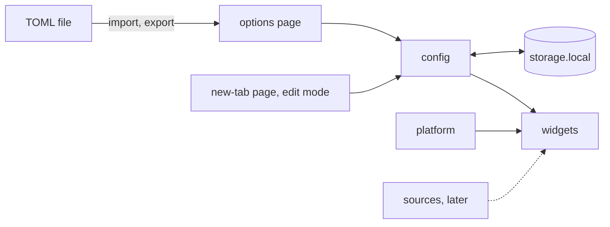

# Architecture

How hull is built and why. Read it before changing how the parts fit
together. It describes the prototype; most of it is not built yet.

Draft: the owner has not approved it yet.

## Scope

hull is the owner's new-tab page and home page. It shows the owner's own
things: links to their services and sites, a search box and small
widgets. The parts of the first version, in the order they are built:

1. the new-tab page with the clock and date, from the default config;
2. the links grid, from the config in `storage.local`, with a first
   options page: the config as TOML in a text box, checked and saved;
3. the search box;
4. the options page: import and export of TOML files;
5. edit mode on the page: add, change, move and remove links;
6. notes.

Later, in no fixed order:

- programs on the owner's machine: widgets that read from them and
  actions that call them, such as TITAN tasks;
- weather;
- the config and the notes in sync between machines, see the open
  questions;
- a public listing on AMO, maybe the Chrome Web Store.

## Bird's eye view



hull is two extension pages and no background script. The new-tab page
draws the widgets in the order the config gives; the options page edits
the config as TOML. Both read and write the config only through
`src/config/`, which keeps it in `storage.local` on this machine. A page
re-renders on `storage.onChanged`, so a change in one tab shows in every
open tab. A page the browser kept for Back misses those events, so it
reads the config again when it is shown from that cache.

## Code map

- `public/manifest.json`: Manifest V3, written by hand. The new-tab
  override, the home page override for Firefox, the Gecko id, the
  permissions. Vite copies `public/` into `dist/` as it is.
- `newtab.html`, `src/newtab/`: the page, the layout and edit mode. An
  "Edit" link in the corner opens the options page.
- `options.html`, `src/options/`: the TOML editor, import and export.
  Firefox opens it from about:addons, in a tab of its own. A link at the
  top goes back to the new tab.
- `src/base.css`: what every page shares.
- `src/widgets/`: `clock/`, `links/`, `search/`, `notes/`. A widget gets
  its typed config as props and renders it.
- `src/config/`: the schema, the defaults, TOML to config and back,
  validation, migrations and storage. `store.ts` is the part of
  `storage.local` it uses, so tests run on a store in memory;
  `useConfig` gives a page the config and follows every save.
- `src/platform/`: not built yet; checks and calls for APIs that differ
  between browsers, such as the theme.
- `src/sources/`: not built yet; the only code that will talk to
  programs outside the extension.
- `src/config/default.toml`: the config of a first run, bundled as text.
- `scripts/`: `check.sh` behind `npm run check`, `lint.js` for
  `web-ext lint`, `dev.sh` behind `npm run dev`, `chromium/` behind
  `npm run dev:chromium`.
- `.github/workflows/check.yml`: `npm run check` on every pull request
  and on `master`.

## The config

The owner writes it in TOML; a sketch of the format:

```toml
version = 1

[layout]
widgets = ["clock", "search", "links", "notes"]

[[groups]]
name = "Home"
links = [
  { name = "Router", url = "http://192.168.1.1" },
  { name = "TITAN", url = "http://localhost:8000" },
]
```

- TOML is the format to edit and to exchange, not the format stored.
  Import parses and validates a file and stores it at once, as plain
  objects, in place of the config and of any unsaved text in the editor;
  a file with an error changes nothing. Export and the options page
  write TOML from the stored config, so an exported file always imports,
  and comments of an imported file are not kept. Export is a download of
  `hull.toml` from the page, with no `downloads` permission.
- A link is `http` or `https`, nothing else: a link must never run code
  (`javascript:`) or carry a document of its own (`data:`).
- `groups` may be left out; it means no links.
- The search has no settings: it uses the engine the browser's own
  settings make the default.
- `storage.local` holds two keys:

| Key | Holds |
| --- | --- |
| `config` | the whole config |
| `notes` | the notes, not built yet |

- `version` is the version of the schema. A stored config of an older
  version is migrated when it is read, by a function in `src/config/`.
- The browser deletes `storage.local` when the extension is removed, and
  each machine has a config of its own. TOML export and import move it
  by hand until there is sync.

## The widgets

- **Clock:** the time and date in the browser's locale, with
  `Intl.DateTimeFormat`; it redraws when the minute changes.
- **Links:** the groups and their links as a grid. A link is a plain
  `<a>`, so a middle click opens a new tab as usual. A tile shows the
  first letter of the name; favicons are an open question.
- **Search:** `search.query` with the browser's default engine, the same
  call in Firefox and Chromium; results open in the same tab.
- **Notes:** plain text, saved as the owner types.

## Browsers

Firefox comes first; Chromium runs the same build. Where an API is
missing, `src/platform/` gives the fallback:

| Feature | Firefox | Chromium |
| --- | --- | --- |
| New tab | `chrome_url_overrides` | the same |
| Home page | `chrome_settings_overrides` | not set; the owner points the home button at the new tab |
| Search | `search.query`, the default engine | the same |
| Theme colors | `theme.getCurrent` | `prefers-color-scheme` |
| Storage | `storage.local` | the same |

Neither browser shows an extension's new tab in a private window.

## Invariants

- Only `src/config/` reads or writes `browser.storage`. Widgets get typed
  config and never touch storage.
- Only `src/platform/` calls an API that differs between browsers, and it
  checks before the call. A missing feature is not an error: the widget
  falls back or hides, and the page runs on.
- Only `src/sources/` will talk to anything outside the extension.
- Bad config never blanks the page. TOML that fails to parse is refused
  with the line and the reason, TOML that fails to validate with the key
  and the reason, such as `layout.widgets[1]: unknown widget "clok"`;
  unknown keys are refused too, so a typo does not pass unseen. A
  stored config that fails validation is replaced by the defaults for
  that page, with a banner that says so.
- All code ships in the bundle: no remote code, no `eval`, the default
  content security policy, only the permissions in use. These are AMO
  rules, kept from the first day.
- The build is reproducible: `npm ci && npm run build` from the source
  gives the same files, as AMO review requires for a bundled build.

## Decisions

- **Firefox first, Chromium too.** One Manifest V3 build on the common
  WebExtension API. Firefox-only features sit behind checks in
  `src/platform/`.
- **The `browser` namespace with promises, no polyfill.** Firefox has it
  and Chrome has it from version 148.
- **TypeScript, Preact and Vite.** TSX like ags-rubick; Preact is small,
  and edit mode and the options page have enough state for components.
  Vite builds the two pages.
- **No extension framework.** The manifest is written by hand and
  web-ext runs, lints and packages the build. WXT is the fallback when
  the browsers need manifests too different for one file, or hull grows
  a background script or content scripts.
- **No `@preact/preset-vite`.** Vite compiles the JSX for Preact itself;
  the preset's hot reload needs Vite's dev server, which an extension
  build does not use, and it brings Babel.
- **The lint fails on warnings, but one.** Preact sets `innerHTML` for
  `dangerouslySetInnerHTML`, and `web-ext lint` warns about it in every
  build. `scripts/lint.js` allows that one warning; `check.sh` fails on
  `innerHTML` in `src/` instead.
- **No background script yet.** The two pages need none.
- **The config is stored as objects, TOML is for editing.** Edit mode
  changes the objects; TOML text would have to be rewritten on every
  change and would lose its comments anyway.
- **`storage.local` for the config and the notes.** No account and no
  limit that matters for a config or notes; `storage.sync` would cap an
  item at 8 KB and all of it at 100 KB. The cost: each machine has its
  own config until there is sync.
- **Letter tiles, not favicons, for now.** Favicons would mean a request
  to every linked site.
- **Types for `browser` from `@types/firefox-webext-browser`.** They are
  made from Firefox's own API schemas, for the namespace hull uses; only
  in development.
- **The options page reads the text box when it saves,** not the state of
  the last render, which can be behind when the form is sent right after
  an input. `src/options/Options.test.tsx` sends the form in the same
  tick as the input, in happy-dom, and fails on the old way.
- **happy-dom for the few component tests.** Only in development, and
  only where a page's behavior needs a test; the logic stays in
  `src/config/` and `src/platform/`, tested without a DOM.
- **Library defaults first.** A setting is added only when a default
  breaks something.

## Open questions

Proposals the owner has not decided yet:

- Programs on the owner's machine: native messaging, where hull starts a
  helper and talks JSON with it, or `fetch` to a server the program runs
  on `127.0.0.1`, with authentication.
- Sync between machines: a file in the hidden app folder of the owner's
  Google Drive (the `drive.appdata` scope), signed in with
  `identity.launchWebAuthFlow`, which Firefox and Chromium both have. It
  needs a Google OAuth client of the owner's and a host permission for
  the Google APIs. Drive keeps a copy and hull reads and writes it; when
  two machines change the config, the newer one wins.
- The TOML library: `smol-toml`, which parses and writes TOML and has no
  dependencies.
- Favicons: fetched from each site, or kept as letter tiles.
- The layout: a fixed order of widgets now; a free grid later?
